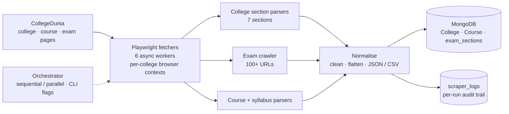

# CollegeDunia ETL Pipeline


**A production-style ETL engine that turns dynamic education websites into a clean, queryable MongoDB dataset — concurrently, idempotently, and resumably.**

Built during a data science internship to replace one-off scripts with a pipeline that could be re-run every day without duplicating a single document.

---

## The problem

College, course, and exam information is spread across thousands of pages that are rendered client-side by React and Next.js. A naive scraper breaks the moment it meets a hashed CSS class, and a naive loader duplicates every record on the second run.

This pipeline addresses both: it extracts by **structure and heading text** rather than fragile class names, and it writes with **MongoDB upserts** keyed on a stable slug, so re-running it is always safe.

---

## What it extracts

| Domain | Scope | Sections |
|---|---|---|
| **Colleges** | Hundreds of colleges | Admission · Placement · Courses & Fees · Cutoff · Info · Q&A · Scholarship |
| **Exams** | 100+ exam pages | Overview · Eligibility · Syllabus · Cutoff · Preparation |
| **Courses** | B.Com, M.Com, M.Sc, Polytechnic | Course catalog and syllabus pages |

---

## Architecture



The orchestrator (`collegedunia_etl/mongodb_pipeline/main.py`) decides what runs, in what order, and with how much concurrency. Each scraper owns its own parsing logic and writes to its own collection.

---

## Engineering highlights

**Concurrency without corruption**
Six colleges are scraped in parallel with `asyncio`, each in its own browser context. Sessions never share page state, which removed the intermittent timeouts and cross-contaminated documents that a single shared context produced.

**Idempotent loads**
Every write is an `update_one(..., upsert=True)` keyed on a normalised slug, so the same pipeline can run repeatedly and the collection converges instead of growing duplicates.

**Resumable runs**
URLs that fail are written to `failed_urls.txt` alongside the run's logs, so a crashed or partially completed run can be restarted without re-scraping everything.

**Resilient against dynamic markup**
Selectors resolve elements by heading text and page structure rather than generated class names, which change on every front-end deploy.

**Observable by default**
Each run writes a summary — what ran, how long it took, document counts, and failures — and appends to a `logs` collection in MongoDB, so history is queryable instead of buried in a terminal.

**One command, many modes**

```bash
python collegedunia_etl/mongodb_pipeline/main.py                          # all scrapers, sequential
python collegedunia_etl/mongodb_pipeline/main.py --parallel               # all scrapers, concurrent
python collegedunia_etl/mongodb_pipeline/main.py --scrapers colleges,exams
python collegedunia_etl/mongodb_pipeline/main.py --scrapers exams --limit 10
python collegedunia_etl/mongodb_pipeline/main.py --test-db                # verify MongoDB connectivity
```

---

## Quickstart

```bash
git clone https://github.com/mala9311/ETL-pipeline.git
cd ETL-pipeline

python -m venv .venv
.venv\Scripts\activate          # Windows
# source .venv/bin/activate     # macOS / Linux

pip install -r requirements.txt
playwright install chromium
```

Point the pipeline at your MongoDB instance (local by default):

```bash
# Windows PowerShell
$env:MONGO_URI_LOCAL = "mongodb://localhost:27017/"

# macOS / Linux
export MONGO_URI_LOCAL="mongodb://localhost:27017/"
```

Verify the connection, then run a small batch:

```bash
python collegedunia_etl/mongodb_pipeline/main.py --test-db
python collegedunia_etl/mongodb_pipeline/main.py --scrapers exams --limit 5
```

---

## Configuration

| Setting | Where | Default |
|---|---|---|
| `MONGO_URI_LOCAL` | Environment variable | `mongodb://localhost:27017/` |
| Database | `Config` in `mongodb_pipeline/main.py` | `collegedunia` |
| Collections | `Config.COLLECTIONS` | `College`, `Course`, `exam_sections`, `scraper_logs` |
| Concurrency | `CONCURRENT_COLLEGES` in `college/colleges.py` | `6` |
| Page timeout | `PAGE_TIMEOUT` | `30_000 ms` |
| Retries | `Config.MAX_RETRIES` / `RETRY_DELAY` | `3` / `5 s` |

---

## Project structure

```
ETL-pipeline/
├── collegedunia_etl/
│   ├── college/
│   │   ├── colleges.py              # concurrent college scraper
│   │   └── sections/                # admission, placement, fees, cutoff, info, Q&A, scholarship
│   ├── courses/sections/            # course and syllabus scrapers
│   ├── exam/
│   │   ├── New_Scraper/             # exam URL discovery and section parsing
│   │   └── Previous_Scraper/        # overview, eligibility, syllabus, cutoff, preparation
│   ├── mongodb_pipeline/
│   │   ├── main.py                  # orchestrator (CLI, parallel mode, summaries)
│   │   ├── colleges.py
│   │   ├── courses.py
│   │   └── exams.py
│   └── utils/logger.py
├── colleges_upto_rank_500.csv       # seed list of college URLs
├── urlof500college.py               # seed URL builder
└── *_scraped.json / *.csv           # sample exported outputs
```

---

## Output

Data lands in MongoDB, with flat JSON and CSV exports kept in the repository as samples:

- `Collegedunia-colleges.csv` — seed college list
- `bcom_scraped_flat.csv`, `mcom_scraped.json` — flattened course records
- `faq_results.csv` — structured Q&A pairs

---

## Tech stack

`Python` · `Playwright` · `asyncio` · `PyMongo` · `Pandas` · `tqdm`

---

## Possible next steps

- Move configuration into a `.env` file and add a scheduler (cron or Prefect) for daily refresh.
- Add schema validation with Pydantic before the Mongo write, so malformed pages fail loudly.
- Emit Prometheus-style counters per section for trend monitoring across runs.
- Add a small FastAPI read layer so the dataset can be queried without touching Mongo directly.

---

## License

MIT
